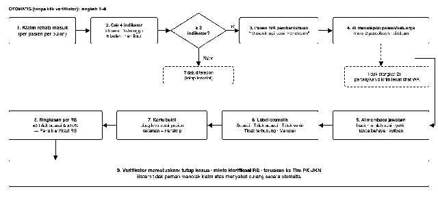
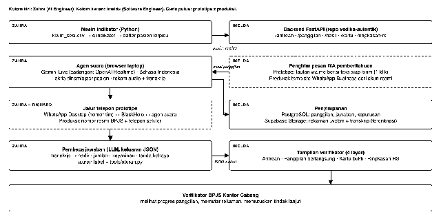
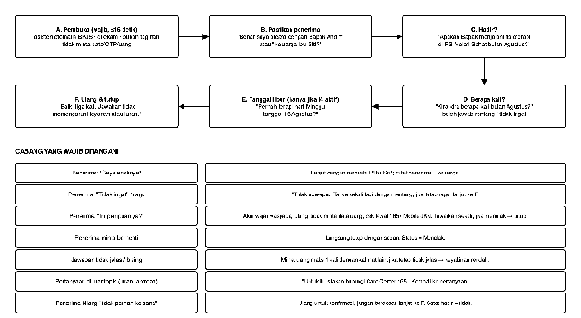
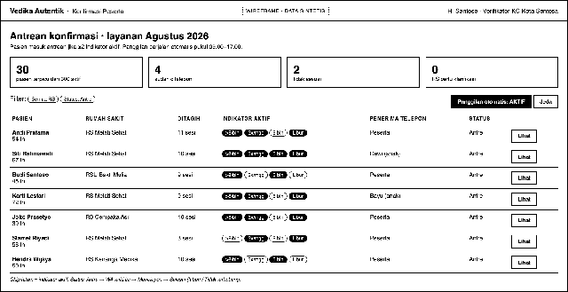
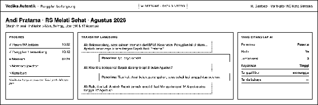
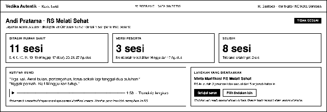
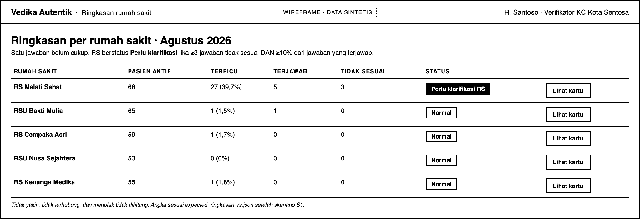

**Vedika Autentik**

PRD v3.0 · Konfirmasi suara peserta untuk klaim fisioterapi

| Item | Isi |
| :---- | :---- |
| Tanggal | 28 Oktober 2026 |
| Pemilik produk | Richard (PM) |
| AI Engineer | Zahra |
| Software Engineer | Imelda |
| Kategori lomba | Efisiensi Risiko pada Fasilitas Kesehatan (Healthkathon 2026\) |
| Tenggat prototipe | Minggu, 1 November 2026, link video tersubmit paling lambat pukul 15.00 |
| Data uji | Folder data-uji-konfirmasi (dibahas di bagian 10\) |
| Repo | github.com/imeldamayanti/vedika-autentik · branch feat/konfirmasi-suara (sudah di-push, commit 7ca9f91 berisi data uji). Fitur v3 dibangun di branch ini, bukan di main. |

# **1\. Ringkasan**

Vedika Autentik menandai klaim fisioterapi yang polanya janggal, lalu AI menelepon pasien atau keluarganya untuk menanyakan berapa kali mereka benar-benar terapi. Jawaban yang tidak cocok dengan tagihan disimpan sebagai rekaman dan transkrip. Verifikator memakainya sebagai bukti awal untuk meminta klarifikasi ke rumah sakit sebelum kerugian membesar.

## **Yang berubah dari v2**

* Pemeriksaan keaslian berkas PDF dihapus.

* Alasannya: sejak SEB lima lembaga 30 Juli 2026, klaim JKN bergeser ke RME SATUSEHAT ("No RME, No Claim", berlaku penuh 2027). Berkas pindaian tidak lagi jadi sumber bukti utama.

* Konfirmasi peserta, yang di v2 hanya pelengkap, sekarang menjadi inti produk.

* Nama dan posisi tetap: Vedika Autentik adalah fitur di dalam VEDIKA untuk verifikator BPJS.

# **2\. Masalah dan alasan memilih solusi ini**

## **2.1 Pernyataan masalah**

Verifikator tidak punya cara yang murah dan cepat untuk memastikan sesi fisioterapi yang ditagih benar-benar dijalani pasien. Konfirmasi ke pasien terbukti membongkar kecurangan, tetapi saat ini dilakukan manual dan baru setelah klaim dibayar.

## **2.2 Bukti**

| Temuan | Data | Sumber |
| :---- | :---- | :---- |
| Modus terbukti di Indonesia | Fisioterapi dilakukan 2 kali, ditagih 10 kali. 3.269 dari 4.341 tagihan fisioterapi tidak ada di rekam medis. Tiga RS, sekitar Rp35 miliar. Terungkap setelah pasien dikonfirmasi. | KPK (Juli 2024), Itjen Kemenkes (Juli 2024\) |
| Rehab medik besar | 174.026 kunjungan IRM \= 11,6% kunjungan rawat jalan RS. Estimasi tertimbang 13,9 juta sesi dan Rp2,04 triliun per tahun. | Data panitia: Data Sampel Reguler 2025 (kunjungan 2024\) |
| Pola janggal nyata | Pasien rehab ≥6 bulan \= 15,9% pasien tetapi 46,7% biaya. Ada pasien 163 sesi setahun. 2,5% bulan-pasien \>8 sesi. 466 sesi di hari Minggu. | Data panitia |
| Konfirmasi sudah ada, tapi manual | BPJS bisa konfirmasi ke peserta saat Verifikasi Pasca Klaim (VPK) dan Audit Administrasi Klaim (AAK), yaitu setelah klaim dibayar. | Kontan, pernyataan BPJS |
| Banyak pasien perlu didampingi | 34,9% kunjungan rehab oleh usia ≥60 tahun dan 17,0% oleh anak \<13 tahun. | Data panitia |
| Takut penipuan | BPJS berulang kali mengimbau soal penipuan telepon dan WhatsApp atas nama BPJS. | detik, Bisnis (2023–2024) |

## **2.3 Kecocokan masalah dan solusi**

| Masalah | Fitur yang menjawab | Kenapa cocok |
| :---- | :---- | :---- |
| Tidak tahu sesi benar terjadi | F3 Panggilan AI | Saksi dari luar RS, cara yang sama yang membongkar kasus KPK |
| Tidak mungkin menelepon semua pasien | F1 Indikator, pemicu ≥2 indikator | 2,3% bulan-pasien (561 pasien di data panitia), ±6.400 panggilan per bulan secara nasional |
| Pasien mengira penipuan | F2 Pesan WA pemberitahuan | Pasien tahu akan ditelepon dan tahu apa yang tidak akan diminta |
| Lansia dan anak tidak bisa menjawab | F1 \+ F3 menelepon keluarga | Lebih dari separuh kunjungan rehab |
| Jawaban tidak rapi atau berlogat | F4 Pembaca jawaban AI | Aturan tekan-tombol tidak bisa memahami "cuma dua kali kok" |
| Satu jawaban belum bukti; RS jujur takut dituduh | F5 Kartu bukti \+ ringkasan RS \+ keputusan manusia | Toleransi salah ingat 2 sesi; RS baru diklarifikasi setelah ≥3 jawaban tidak sesuai |

# **3\. Pengguna dan target**

| Pengguna | Yang dilakukan di sistem |
| :---- | :---- |
| Verifikator BPJS Kantor Cabang (utama) | Memantau antrean dan panggilan, membaca kartu bukti, memutuskan tindak lanjut. |
| Peserta atau keluarga | Menerima pesan WA dan telepon sekitar 2 menit, menjawab 2–3 pertanyaan. Tidak perlu aplikasi atau login. |
| Tim Pencegahan Kecurangan JKN | Menerima kasus yang diteruskan verifikator. |

## **Target prototipe (1 November)**

* 8 dari 8 skenario uji lulus.

* Indikator cocok untuk 300 dari 300 pasien.

* Pembaca jawaban benar untuk minimal 90% field kunci pada 20 uji.

* Panggilan selesai dalam 2,5 menit, dengan paling banyak 3 pertanyaan inti.

## **Target pilot (setelah lomba, diukur langsung)**

* Persentase telepon yang diangkat.

* Persentase jawaban tidak sesuai.

* Jumlah RS yang diminta klarifikasi dan nilai klaim yang dikoreksi.

# **4\. Lingkup**

| Masuk (wajib jalan 1 Nov) | Tidak masuk |
| :---- | :---- |
| F1 Indikator dan antrean F2 Pesan WA pemberitahuan F3 Panggilan AI otomatis F4 Pembaca jawaban dan label F5 Kartu bukti, ringkasan RS, keputusan verifikator | Deteksi dokumen PDF (v2 dihentikan) Panggilan acak 10% (fase berikut) Poli selain rehab medik Bahasa daerah penuh (hanya Bahasa Indonesia santai) Integrasi VClaim atau Mobile JKN nyata Menolak klaim atau menyebut curang secara otomatis Surat klarifikasi otomatis ke RS |

# **5\. Alur sistem**

Langkah 1 sampai 8 berjalan tanpa klik verifikator. Verifikator hanya masuk di langkah 9\.

*Gambar 1\. Alur dari klaim masuk sampai keputusan verifikator*

# **6\. Arsitektur dan pembagian kerja**

*Gambar 2\. Komponen, pemilik, dan beda prototipe dengan produksi*

| Keputusan | Pilihan | Alasan |
| :---- | :---- | :---- |
| Model suara | Gemini Live; cadangan OpenAI Realtime | Real-time, Bahasa Indonesia, ada kuota uji. Dipastikan saat uji Kamis pagi. |
| Model pembaca jawaban | LLM dengan keluaran JSON (structured output) | Memahami bahasa santai; label tetap dihitung aturan supaya bisa diaudit. |
| Jalur telepon prototipe | WhatsApp Desktop (nomor tim) \+ BlackHole | Gratis, HP benar-benar berdering. Produksi memakai nomor resmi BPJS. |
| Backend | FastAPI \+ PostgreSQL \+ Supabase Storage (repo vedika-autentik) | Sudah ada; tidak mulai dari nol. |
| Frontend | Vanilla JS, gaya desain Vedika Autentik | Sama dengan prototipe yang sudah live. |

# **7\. Fitur dan requirement**

* PIC: **Z** \= Zahra (AI Engineer), **I** \= Imelda (Software Engineer), **R** \= Richard (PM).

* Satu requirement dianggap selesai jika kriteria terimanya lulus.

## **F1. Indikator dan antrean**

Tujuan: memilih sedikit pasien yang paling perlu ditanya, dengan aturan yang bisa dijelaskan dalam satu kalimat.

| Kode | Indikator (per pasien, per RS, per bulan layanan) | Alasan |
| :---- | :---- | :---- |
| I1 | Sesi ditagih \> 8 dalam sebulan | Melewati batas Perdir BPJS 05/2018 (2 kali seminggu) |
| I2 | Ada satu minggu (Senin–Minggu) dengan ≥3 sesi | Batas mingguan yang sama |
| I3 | Ada sesi di 6 bulan berturut-turut sampai bulan ini | Episode panjang menyedot 46,7% biaya rehab |
| I4 | Ada sesi di hari Minggu atau libur nasional | Poli rehab umumnya tutup |

| ID | Requirement | PIC | Kriteria terima |
| :---- | :---- | :---- | :---- |
| R1.1 | Hitung I1–I4 dari klaim\_sesi.csv persis seperti tools/aturan.py. | Z | python3 tools/uji.py indikator keluaran.csv → LULUS 300/300 |
| R1.2 | Pasien masuk antrean jika ≥2 indikator aktif. Di bawah itu tidak ditelepon. | Z | S7 (Rina, hanya I3) tidak muncul di antrean |
| R1.3 | Penerima telepon \= keluarga jika hubungi\_keluarga \= ya (usia ≥60 atau \<13 dan ada kontak keluarga). Selain itu peserta. | I | S2 dan S4 menelepon anak; S1 menelepon peserta |
| R1.4 | Layar Antrean: pasien, RS, sesi ditagih, chip indikator, penerima, status (Antre, WA terkirim, Menelepon, Selesai, Tidak terhubung). | I | Sesuai Gambar 4, data dari GET /antrean |
| R1.5 | Mode otomatis: saat AKTIF, sistem memproses antrean satu per satu (prototipe: 1 panggilan aktif), hanya pukul 09.00–17.00. Ada tombol Jeda. | I | Setelah mode diaktifkan, S1 diproses tanpa klik tambahan |

## **F2. Pesan WA pemberitahuan**

Tujuan: pasien tahu akan ditelepon dan tidak mengira panggilan itu penipuan.

| ID | Requirement | PIC | Kriteria terima |
| :---- | :---- | :---- | :---- |
| R2.1 | Sebelum panggilan, kirim pesan teks Lampiran B ke penerima. Prototipe: sistem membuka tautan wa.me berisi teks siap kirim ke nomor penguji; operator menekan kirim. Produksi: template WhatsApp Business dari akun resmi bercentang. | I | Pesan masuk ke HP penguji sebelum panggilan di S1–S8 |
| R2.2 | Jeda pesan ke panggilan: produksi 10 menit, prototipe bisa diatur (bawaan 1 menit). | I | Jeda tercatat di log panggilan |
| R2.3 | Pesan tidak berisi tautan, tidak meminta data, menyebut nomor yang akan menelepon dan cara cek lewat Care Center 165\. | I | Teks sama dengan Lampiran B |

## **F3. Panggilan AI**

Tujuan: dalam sekitar 2 menit, mendapat jawaban "hadir atau tidak" dan "berapa kali" langsung dari pasien atau keluarga, tanpa membuat mereka bingung atau takut.

| ID | Requirement | PIC | Kriteria terima |
| :---- | :---- | :---- | :---- |
| R3.1 | Agen suara real-time Bahasa Indonesia. Skrip diisi otomatis dari data: nama penerima, nama pasien, RS, bulan, tanggal libur (jika I4 aktif). | Z | S1 menyebut "RS Melati Sehat", "Agustus", "16 dan 17 Agustus" |
| R3.2 | Ikuti alur A–F dan tangani 7 cabang di Gambar 3\. | Z | Semua perilaku\_ai\_wajib di skenario\_uji.json terpenuhi |
| R3.3 | Aturan bicara: mengaku asisten otomatis; satu pertanyaan per giliran; kalimat ≤20 kata; tidak meminta NIK, OTP, rekening, atau uang; tidak memakai kata "curang" atau "fraud"; tidak berdebat; mengulang jawaban penting untuk konfirmasi. | Z | Dicek manual pada transkrip S1–S8 |
| R3.4 | Rekam audio dua arah dan transkrip bertanda waktu; kirim ke POST /panggilan/{id}/hasil saat selesai. | Z \+ I | Rekaman bisa diputar di kartu bukti S1 |
| R3.5 | Maksimal 2 percobaan (jeda prototipe 2 menit, produksi 2 jam). Jika tetap tidak diangkat, kirim chat WA berisi pertanyaan jumlah sesi dengan pilihan jawaban (Lampiran B). | I | S5 berakhir Tidak terhubung dan chat terkirim |
| R3.6 | Jalur prototipe WhatsApp Desktop ↔ BlackHole ↔ agen (Lampiran C). | Z \+ R | Gerbang Kamis 12.00: 3 panggilan berturut-turut jelas, transkrip ≥90% benar |
| R3.7 | Kirim status ke backend: WA terkirim, menelepon, tersambung, merekam, membaca jawaban, selesai. | Z \+ I | Status muncul di layar Panggilan (Gambar 5\) tanpa muat ulang manual |

*Gambar 3\. Alur percakapan AI dan cabang yang wajib ditangani*

## **F4. Pembaca jawaban dan label**

Tujuan: mengubah percakapan bebas menjadi data yang bisa dibandingkan dengan tagihan. LLM hanya mengekstrak. Label dihitung aturan agar bisa diaudit.

| ID | Requirement | PIC | Kriteria terima |
| :---- | :---- | :---- | :---- |
| R4.1 | LLM membaca transkrip dan mengeluarkan JSON sesuai skema di README data uji: status\_panggilan, penerima, hubungan, hadir, jumlah\_min, jumlah\_maks, keyakinan, tanda\_bahaya, membantah\_tanggal\_libur, kutipan\_kunci, ringkasan. | Z | python3 tools/uji.py jawaban keluaran.json → LULUS untuk transkrip S1–S6, S8 |
| R4.2 | tanda\_bahaya hanya boleh berisi: tanda\_tangan\_tanpa\_layanan, diminta\_membayar, layanan\_berbeda. | Z | S2 → tanda\_tangan\_tanpa\_layanan |
| R4.3 | Jika JSON tidak valid, ulangi 1 kali. Jika tetap gagal, label Tidak yakin dan catat galat. | Z | Uji dengan transkrip kosong |
| R4.4 | Label dihitung dengan aturan di tabel berikut (tools/aturan.py), dipakai sama di backend. | Z \+ I | Label S1–S8 sama dengan expected\_label |
| R4.5 | Uji 20 jawaban tambahan buatan tim (santai, ragu, keluarga, bising). | Z | ≥90% field kunci benar; hasil masuk slide uji |

| No | Kondisi | Label | Langkah yang disarankan |
| :---- | :---- | :---- | :---- |
| 1 | Tidak diangkat 2 kali | Tidak terhubung | Pantau. Tidak dihitung. |
| 2 | Penerima menolak menjawab | Menolak | Pantau. Tidak dihitung. |
| 3 | hadir \= tidak | Tidak sesuai | Minta klarifikasi RS |
| 4 | Ada tanda bahaya | Tidak sesuai | Minta klarifikasi RS |
| 5 | Jumlah tidak disebut atau keyakinan rendah | Tidak yakin | Pantau. Tidak dihitung. |
| 6 | Sesi ditagih − jumlah\_maks \> 2 | Tidak sesuai | Minta klarifikasi RS |
| 7 | Selain itu | Sesuai | Tutup kasus |

## **F5. Kartu bukti, ringkasan RS, dan keputusan**

Tujuan: verifikator bisa memeriksa sendiri buktinya dalam satu layar dan memutuskan dengan alasan yang tercatat.

| ID | Requirement | PIC | Kriteria terima |
| :---- | :---- | :---- | :---- |
| R5.1 | Layar Panggilan berlangsung: progres, transkrip mengalir, field yang ditangkap AI. | I | Sesuai Gambar 5 |
| R5.2 | Kartu bukti: label, ditagih vs versi penerima vs selisih, daftar tanggal (Minggu/libur ditandai), kutipan kunci, pemutar rekaman, transkrip lengkap, langkah yang disarankan. | I | Kartu S1: 11 vs 3, selisih 8, label Tidak sesuai (Gambar 6\) |
| R5.3 | Keputusan: Setujui saran, atau pilih tindakan lain (Tutup kasus, Minta klarifikasi RS, Teruskan ke Tim PK-JKN) dengan alasan wajib. Simpan siapa, kapan, apa, alasan. | I | Tindakan lain tanpa alasan tidak bisa disimpan |
| R5.4 | Ringkasan RS: pasien aktif, terpicu (%), terjawab, tidak sesuai, status. Status \= Perlu klarifikasi RS jika tidak sesuai ≥3 DAN ≥10% dari terjawab. Tidak yakin, tidak terhubung, menolak tidak dihitung. | I | Sama dengan expected\_ringkasan\_rs.json di setiap langkah (Gambar 7\) |
| R5.5 | Retensi: Tidak sesuai → rekaman dan transkrip disimpan terenkripsi sampai klarifikasi selesai. Sesuai → rekaman dan transkrip dihapus otomatis 30 hari, hasil terstruktur disimpan. Lainnya → hanya status. | I | Kolom hapus\_pada terisi benar per label |
| R5.6 | Identitas penerima tidak pernah tampil di data yang dibagikan ke RS. Semua layar prototipe berlabel "Simulasi". | I | Cek visual |

# **8\. Wireframe**

Hitam putih, untuk acuan tata letak. Gaya visual akhir mengikuti prototipe Vedika Autentik yang sudah ada.

*Gambar 4\. Antrean konfirmasi*

*Gambar 5\. Panggilan berlangsung*

*Gambar 6\. Kartu bukti*

*Gambar 7\. Ringkasan rumah sakit*

# **9\. Data uji dan kasus uji**

Folder **data-uji-konfirmasi** sudah di-commit dan di-push ke GitHub (repo imeldamayanti/vedika-autentik, branch feat/konfirmasi-suara, commit 7ca9f91). Ambil dengan: git fetch lalu git switch feat/konfirmasi-suara. Isinya:

* 408 peserta sintetis di 5 RS fiktif, dengan 4.913 klaim sesi rehab Maret–Agustus 2026\.

* Sebaran jumlah sesi per bulan diambil dari data panitia secara agregat. Tidak ada baris peserta riil.

* RS Melati Sehat sengaja disisipi pola curang.

* Hasil yang diharapkan dihitung oleh tools/aturan.py dan dicek dengan tools/uji.py.

## **Skenario uji**

| ID | Kasus | Penerima | Ditagih / nyata | Yang dikatakan penguji | Hasil yang diharapkan |
| :---- | :---- | :---- | :---- | :---- | :---- |
| S1 | Andi Pratama, RS Melati Sehat | Peserta | 11 / 3 | "Tiga kali." "Hari Minggu kan tutup." | Tidak sesuai, selisih 8, rekaman disimpan, RS Melati jadi Perlu klarifikasi |
| S2 | Siti Rahmawati, 67, RS Melati Sehat | Dewi (anak) | 10 / 2 | "Dua kali aja... disuruh tanda tangan beberapa lembar." | Tidak sesuai \+ tanda\_tangan\_tanpa\_layanan |
| S3 | Budi Santoso, RSU Bakti Mulia | Peserta | 9 / 9 | "Sembilan atau sepuluh kali." | Sesuai, kasus ditutup, AI tidak bertanya soal libur |
| S4 | Karti Lestari, 72, RS Melati Sehat | Bayu (anak) | 9 / 6 | "Kurang tahu persis, mungkin lima atau enam." | Tidak yakin, tidak dihitung |
| S5 | Joko Prasetyo, RS Cempaka Asri | Peserta | 10 / 10 | Tidak mengangkat 2 kali | Tidak terhubung, chat WA terkirim |
| S6 | Slamet Riyadi, RS Melati Sehat | Peserta | 8 / 2 | "Cuma dua kali kok." "Minggu ya libur to mas." | Tidak sesuai (bahasa santai tetap dipahami) |
| S7 | Rina Marlina, RSU Nusa Sejahtera | — | 4 / 4 | Tidak ada panggilan | Tidak masuk antrean (hanya I3) |
| S8 | Hendra Wijaya, RS Kenanga Medika | Peserta | 10 / 10 | "Ini penipuan ya?" lalu menolak | AI menenangkan sekali lalu menutup. Menolak, tidak dihitung |

## **Ringkasan RS yang diharapkan**

* Sebelum skenario: RS Melati Sehat Normal (2 tidak sesuai dari 4 terjawab).

* Setelah S1: RS Melati Sehat menjadi Perlu klarifikasi RS (3 dari 5).

* RS lain tetap Normal sampai semua skenario selesai.

* Pasien terpicu di Agustus: RS Melati 39,7%, RS lain 0–1,8%.

## **Definisi selesai**

1. uji.py indikator LULUS 300/300.

2. uji.py jawaban LULUS untuk transkrip S1–S6 dan S8.

3. S1–S8 dijalankan dengan panggilan sungguhan ke HP penguji; label, kartu, dan bukti tersimpan sama dengan skenario\_uji.json.

4. Ringkasan RS sama dengan expected\_ringkasan\_rs.json setelah S1 dan setelah semua skenario.

5. Satu rekaman demo utuh (S1 lalu S2) tersimpan sebagai cadangan sebelum Sabtu 18.00.

# **10\. Privasi dan etika**

* Dasar pemrosesan: tugas pelayanan publik oleh badan publik (UU PDP Pasal 20 huruf e). Pemberitahuan rekaman tetap disampaikan di awal panggilan.

* Data minimum: AI tidak pernah meminta data. Hanya rekaman, transkrip, dan hasil terstruktur yang disimpan, dengan retensi R5.5.

* Rekaman adalah bukti awal untuk klarifikasi, tidak pernah dipakai sebagai satu-satunya dasar menolak klaim. Satu jawaban tidak pernah mengubah status RS.

* Tidak menjawab, menolak, atau tidak ingat tidak dihitung sebagai sinyal negatif.

* Prototipe memakai data sintetis, nomor tim yang diburamkan di video, dan label "Simulasi". Tidak ada nama atau logo resmi BPJS sebagai penelepon.

# **11\. Risiko dan batasan**

| Risiko | Dampak | Penanganan |
| :---- | :---- | :---- |
| Jalur BlackHole gema atau putus | Demo gagal | Gerbang Kamis 12.00; cadangan web call di browser |
| Pasien salah ingat | RS jujur ikut tertandai | Toleransi 2 sesi; status RS butuh ≥3 jawaban dan ≥10% |
| Pasien ikut kongkalikong atau sudah diarahkan RS | Kecurangan lolos | Pertanyaan menyebut tanggal spesifik. Batasan ini diakui di presentasi. |
| Telepon tidak diangkat | Cakupan turun | Pesan WA lebih dulu, 2 percobaan, chat cadangan. Tingkat angkat diukur saat pilot. |
| Batas 8 sesi (Perdir 05/2018) belum pasti berlaku 2026 | Indikator dipersoalkan | Pemicu butuh 2 indikator; DPJP bisa memberi alasan klinis |

# **Lampiran A. Instruksi sistem agen suara (draf)**

| Peran: Kamu asisten otomatis BPJS Kesehatan yang menelepon untuk konfirmasi singkat layanan fisioterapi. Bicara dalam Bahasa Indonesia yang sopan dan sederhana. Data panggilan: penerima {nama\_penerima} ({hubungan}); pasien {nama\_pasien}; rumah sakit {nama\_rs}; bulan {bulan}; tanggal libur yang ditanyakan: {tanggal\_libur atau "tidak ada"}. Urutan: A. Pembuka: kamu asisten otomatis, panggilan direkam, ini bukan tagihan, kamu tidak akan meminta data pribadi, kode OTP, atau pembayaran. B. Pastikan kamu bicara dengan penerima yang benar. C. Tanyakan apakah pasien menjalani fisioterapi di rumah sakit itu pada bulan itu. D. Tanyakan kira-kira berapa kali. E. Hanya jika ada tanggal libur: tanyakan apakah pernah terapi pada tanggal itu. F. Ulangi jawaban penting, ucapkan terima kasih, sampaikan bahwa jawaban tidak memengaruhi layanan atau iuran, lalu tutup. Aturan: \- Satu pertanyaan per giliran, kalimat maksimal 20 kata. \- Jangan meminta NIK, OTP, rekening, atau uang. Jangan memakai kata curang atau fraud. \- Jangan berdebat dan jangan menebak angka untuk penerima. \- Jika penerima tidak ingat: bilang tidak apa-apa, tanya sekali lagi dengan rentang. Jika tetap ragu, lanjut menutup. \- Jika penerima curiga penipuan: akui itu wajar, tegaskan kamu tidak meminta data atau uang, sarankan cek ke Care Center 165 atau Mobile JKN, tawarkan sekali untuk lanjut. Jika menolak, tutup dengan sopan. \- Jika diminta berhenti, langsung tutup. Pertanyaan di luar topik diarahkan ke Care Center 165\. \- Seluruh panggilan maksimal 2,5 menit. |
| :---- |

# **Lampiran B. Teks pesan WhatsApp**

| Pemberitahuan (sebelum telepon): Halo {nama\_penerima}. Ini BPJS Kesehatan. Dalam {jeda} menit kami akan menelepon dari nomor {nomor\_penelepon} untuk konfirmasi singkat layanan fisioterapi {nama\_pasien} di {nama\_rs} bulan {bulan}. Ini bukan tagihan. Kami tidak akan meminta data pribadi, kode OTP, atau pembayaran. Untuk memastikan pesan ini, hubungi Care Center 165\. |
| :---- |

| Chat cadangan (setelah 2 kali tidak diangkat): Kami belum berhasil menelepon. Kira-kira berapa kali {nama\_pasien} menjalani fisioterapi di {nama\_rs} bulan {bulan}? Balas dengan angka: 1\) 1–2 kali  2\) 3–4 kali  3\) 5–8 kali  4\) lebih dari 8 kali  5\) tidak ingat  6\) tidak pernah terapi di sana. |
| :---- |

# **Lampiran C. Jalur audio prototipe**

1. Pasang driver: brew install blackhole-2ch blackhole-16ch

2. WhatsApp Desktop: speaker \= BlackHole 2ch, mikrofon \= BlackHole 16ch.

3. Agen di browser: input \= BlackHole 2ch (suara penerima), output \= BlackHole 16ch (suara AI) lewat setSinkId.

4. Audio MIDI Setup: buat Multi-Output Device (BlackHole \+ speaker) supaya tim ikut mendengar dan bisa merekam layar.

5. Rekam di browser: gabungkan dua stream dengan MediaRecorder, simpan .webm, kirim ke POST /panggilan/{id}/hasil.

# **Sumber**

* KPK ungkap 3 RS akali klaim BPJS Kesehatan, detik.com, 25 Juli 2024: detik.com/bali/hukum-dan-kriminal/d-7463870

* KPK: ada RS ajukan klaim palsu ke BPJS, Kontan, Juli 2024: nasional.kontan.co.id/news/kpk-ada-rs-ajukan-klaim-palsu-ke-bpjs-diduga-rugikan-negara-puluhan-miliar

* Cegah fraud, RS didorong terapkan klaim elektronik mulai Agustus 2026, Bisnis.com, 31 Juli 2026: finansial.bisnis.com/read/20260731/215/1992660

* BPJS Kesehatan minta faskes bentuk tim anti kecurangan (VPK dan AAK), Kontan: keuangan.kontan.co.id/news/bpjs-kesehatan-minta-faskes-bentuk-tim-anti-kecurangan

* BPJS Kesehatan batasi pelayanan fisioterapi (Perdir 05/2018), Kontan, 2018: nasional.kontan.co.id/news/bpjs-kesehatan-batasi-pelayanan-fisioterapi

* Hati-hati penipuan catut nama BPJS Kesehatan, detik.com: finance.detik.com/moneter/d-6532249

* UU No. 27 Tahun 2022 tentang Pelindungan Data Pribadi, Pasal 20: pasal.id/peraturan/uu/uu-no-27-tahun-2022/pasal-20

* 42 CFR 455.20, verifikasi layanan ke penerima Medicaid (AS): federal-regs.com/title/42/part-455/455.20

* Data Sampel Reguler Edisi 2025 BPJS Kesehatan (data panitia Healthkathon 2026), diolah tim sebagai agregat.

 "Gambar 1. Alur dari klaim masuk sampai keputusan verifikator"

 "Gambar 2. Komponen, pemilik, dan beda prototipe dengan produksi"

 "Gambar 3. Alur percakapan AI dan cabang yang wajib ditangani"

 "Gambar 4. Antrean konfirmasi"

 "Gambar 5. Panggilan berlangsung"

 "Gambar 6. Kartu bukti"

 "Gambar 7. Ringkasan rumah sakit"
